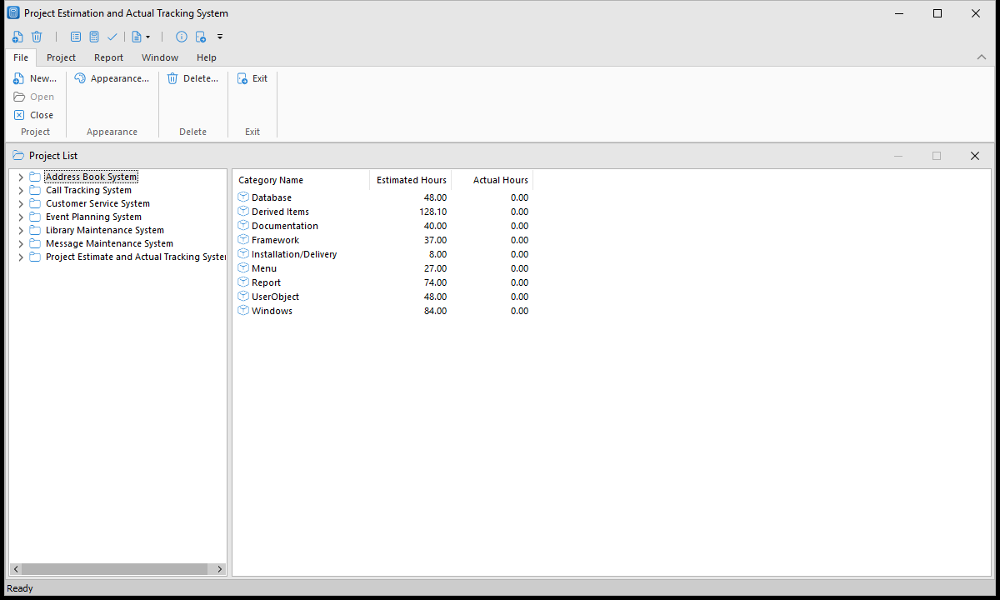

# PEAT, the PFC demo app

PEAT (Project Estimation and Actuals Tracker, the `peat demo app.pbt` target, which builds `peat.exe`) is a small MDI application built with PFC. You keep a list of projects, each with categories, team members, complexities and derived items: a wizard sets a project up, you enter estimates and actual hours, and reports compare them. It shows PFC's frame, sheet and response windows, the explorer (a tree and a list view in a sheet, with a split bar), the DataWindow services, and the application manager's services.



## Setting up

### The database

PEAT reads and updates the PEAT database, which is in [Database-scripts-and-files](https://github.com/OpenSourcePFCLibraries/Database-scripts-and-files):

- **SQL Server:** restore `PEAT.sql_server.bak` (as the database PEAT, for example).
- **SQL Anywhere:** use `peat17.db` with SQL Anywhere 17.

Then point the `[Database]` section of `peat.ini`, in this folder, at it. Keep your own copy of `peat.ini` out of your commits: it holds a password.

### Logon and security

PEAT runs without a logon. To try OpenID Connect logon with the PFC security service, copy `peat_security.ini.example` to `peat_security.ini`, next to `peat.ini`, and fill it in; it describes the settings. `peat_security.ini` is ignored by git.

### The images

The menu, ribbon and toolbar icons, the window icons, the tree and list pictures and the wizard's picture are in `images`, mostly SVG files from Microsoft's [Fluent UI System Icons](https://github.com/microsoft/fluentui-system-icons) (MIT license, in `images\LICENSE-fluentui-system-icons.txt`). A few are PNG files, where PowerBuilder can't show an SVG: the reports' logo (a DataWindow bitmap), the DataWindows' row pointer, and the toolbar pictures of the Report menu's items (the toolbar's drop-down button). The app's icon, `images\peat.ico`, is the calculator icon on a blue square; `images\peat.svg` is its source. PEAT finds the images by their path relative to this folder, so run it with this folder as the current directory, as the IDE and `peat.exe` do when they are here.

They replace the images in [PFC-Demo-App-Image-Files](https://github.com/OpenSourcePFCLibraries/PFC-Demo-App-Image-Files), which PEAT doesn't use any more.

The pictures in PFC's own objects, such as the message box's icons, are in [`pfc libs\images`](../pfc%20libs/images/README.md), and PFC finds them by their file name: add that folder to the system path or to PowerBuilder's application path, or copy its files beside `peat.exe`.

### The appearance

PEAT uses a UI theme and shows its menu as a ribbon. Change them with **File > Appearance**. A new theme and the ribbon setting apply at once; choosing no theme takes effect the next time PEAT starts, because PowerBuilder can't remove a theme while the app runs. The window saves the choices in the `[Application]` section of `peat.ini`:

```ini
[Application]
; The theme's folder in theme (Flat Design Grey by default), or None for no theme
Theme=Flat Design Grey
; 0 shows the classic menu and toolbar instead of the ribbon (1 by default)
RibbonBar=1
```

The themes are PowerBuilder's Flat Design Grey (the default), Blue and Dark, in `theme`. To offer others, copy them next to these from PowerBuilder's `IDE\theme` folder; the Appearance window lists the folders it finds. PEAT applies the theme with `gnv_app.of_ApplyTheme`, so the status bar takes its colors too. The windows, DataWindows and the ribbon use Segoe UI. How to do the same in your own application is in [Giving a PFC application a current look](https://github.com/OpenSourcePFCLibraries/docs/blob/main/user-guide/06-using-pfc-windows-and-menus.md#giving-a-pfc-application-a-current-look), in the PFC User's Guide.
