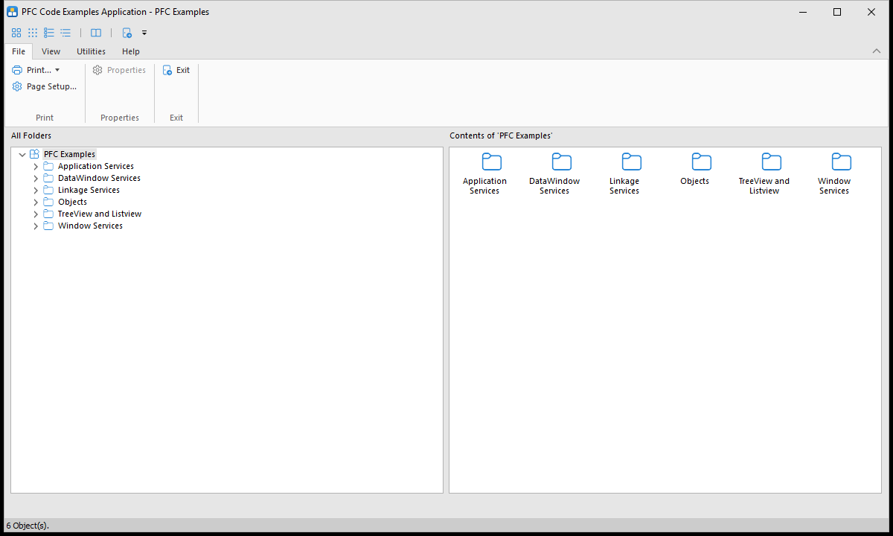

# The PFC Examples app

The Examples app (the `pfc examples` target, `pfc examples.pbt`, which builds `pfcexamp.exe`) is a catalog of small windows, each showing one PFC service or object at work. Its main window lists them in a tree by category; select one and open it to try the service, then look at the window in the IDE to see how it's done.

The examples' source is in `ws_objects/examples`; to build without the IDE, use `pwsh -File tools\build.ps1 -Target "pfc examples"` (see the top-level README).



Each example's help topic is in [PFCEXAMP.pdf](https://github.com/OpenSourcePFCLibraries/Example-application-help-file/releases/latest/download/PFCEXAMP.pdf) ([Example-application-help-file](https://github.com/OpenSourcePFCLibraries/Example-application-help-file)), and the PFC dialogs' help is in [pfcdlg.pdf](https://github.com/OpenSourcePFCLibraries/docs/raw/main/dialog-help/pfcdlg.pdf); put them in this folder, or beside `pfcexamp.exe`. The PFC documentation is in the [docs](https://github.com/OpenSourcePFCLibraries/docs) repository.

## Setting up

### The database

Most examples read and update the EASDEMO sample database, which is in [Database-scripts-and-files](https://github.com/OpenSourcePFCLibraries/Database-scripts-and-files) (the files are also on its [releases page](https://github.com/OpenSourcePFCLibraries/Database-scripts-and-files/releases/tag/1.0)):

- **SQL Server:** restore `EASDEMO.sql_server.bak` (SQL Server 2022) as the database EASDEMO.
- **SQL Anywhere:** use `easdemo17.db` with SQL Anywhere 17, through an ODBC data source. PowerBuilder's own demo database (the "PB Demo DB" ODBC data source) has the same tables and works too.

Then point the `[Database]` section of `examples.ini`, in this folder, at it. The file in the repository uses the PB Demo DB through ODBC:

```ini
[Database]
DBMS=ODBC
DbParm=ConnectString='DSN=PB Demo DB V2021;UID=dba;PWD=<password>',DelimitIdentifier='Yes'
```

For SQL Server, through the Microsoft OLE DB Driver:

```ini
[Database]
DBMS=MSOLEDBSQL SQL Server
ServerName=<server>
LogId=<login>
LogPassword=<password>
AutoCommit=False
DBParm=Provider='MSOLEDBSQL',Database='EASDEMO'
```

Keep your own copy of `examples.ini` out of your commits: it holds a password.

The Security Service example also needs a `[Security]` section, with the same keys, for the PFC security database (`PFC.sql_server.bak` or `pfc17.db` in Database-scripts-and-files); it says so when it opens without one.

### The images

The menu, ribbon and toolbar icons, the tree and list pictures and the examples' pictures are SVG files in `images`, from Microsoft's [Fluent UI System Icons](https://github.com/microsoft/fluentui-system-icons) (MIT license, in `images\LICENSE-fluentui-system-icons.txt`). Where a control can't show SVG, the same icons are PNG files next to them: the status bar's indicators (`sb_*.png`, faded when the service or window is off), the drive pictures, and the splash screen's logo (`pfcexamp.png`, from the app's icon). The examples find them by their path relative to this folder, so run the app with this folder as the current directory, as the IDE and `pfcexamp.exe` do when they are here.

The pictures in PFC's own objects (the message box, the drag-and-drop Sort dialog box, and the printed tree) are in [`pfc libs\images`](../pfc%20libs/images/README.md), and PFC finds them by their file name: add that folder to the system path or to PowerBuilder's application path, or copy its files beside `pfcexamp.exe`. The project names a resource file, `..\examples.pbr`, that isn't in this repository, so the images aren't compiled into the exe.

### The appearance

The app uses a UI theme, shows its menu as a ribbon, and shows help in a window of its own. Change them with **Utilities > Appearance**. A new theme and the ribbon setting apply at once; choosing no theme takes effect the next time the app starts, because PowerBuilder can't remove a theme while the app runs. The window saves the choices as settings in the `[Application]` section of `examples.ini`:

```ini
[Application]
; The theme's folder in theme (Flat Design Grey by default), or None for no theme
Theme=Flat Design Grey
; 0 shows the classic menu and toolbar instead of the ribbon (1 by default)
RibbonBar=1
; PDFViewer shows help in your PDF viewer instead of in the app (InApp by default)
HelpViewer=InApp
```

The themes are PowerBuilder's Flat Design Grey (the default), Blue and Dark, in `theme`. To offer others, copy them next to these from PowerBuilder's `IDE\theme` folder; the Appearance window lists the folders it finds. The app applies a theme with `gnv_app.of_ApplyTheme`, so the status bar takes its colors too. The windows, DataWindows and the ribbon use Segoe UI, and the app's icon is `images\pfcexamp.ico`. How to do the same in your own application is in [Giving a PFC application a current look](https://github.com/OpenSourcePFCLibraries/docs/blob/main/user-guide/06-using-pfc-windows-and-menus.md#giving-a-pfc-application-a-current-look), in the PFC User's Guide.

Help (F1, or **Help > Help Topics**) opens the topic of the example, or of the example or category selected in the main window, with PFC's help service: `gnv_app.of_SetHelp(True)` starts it, and `gnv_app.inv_help.of_SetViewer` chooses the app's help window or your PDF viewer. A topic is the named destination `topic_<help context number>` in `PFCEXAMP.pdf`.

## The example catalog

The main window's tree and list come from two tab-delimited files in this folder, read by `n_cst_examplecatalog` (in `appexmfe.pbl`). They have no header line, and their lines end with CR LF.

`exam.txt` has a line for each example:

| Column | |
|---|---|
| example_id | A number, unique in the file |
| title | The name in the list, and the window's title |
| exhelp | The help context number of its topic in PFCEXAMP.pdf (the named destination topic_<number>): 1000 + example_id |
| window | The window that the example opens |

`examcat.txt` has a line for each item in the tree, a category or an example:

| Column | |
|---|---|
| category_id | A number, unique in the file |
| category_name | The name in the tree |
| category_parent_id | The category it's in (1 Application Services, 6 DataWindow Services, 7 Linkage Services, 27 TreeView and Listview, 34 Window Services, 44 Objects; 0 for the categories themselves) |
| example_id | The example, from `exam.txt`; 0 for a category |
| picture_idx, selected_picture_idx | The tree pictures: 5 and 6 for an example, 3 and 4 for a category |
| state_picture_idx | 0 |
| overlay_picture_idx | 1 marks an example as new |

To add an example: write its window (most inherit from `w_main`, with a short introduction at the top and a Close button), add a line to `exam.txt`, and add a line to `examcat.txt` under its category.  Then add its topic to the help file, in `src/topics.js` in [Example-application-help-file](https://github.com/OpenSourcePFCLibraries/Example-application-help-file), with the same help context number; F1 in the example's window, or with the example selected in the main window, opens it. The window's title comes from the catalog.

These files replaced the `examples` and `examples_categories_list` tables in the EASDEMO database; the app doesn't read the tables any more.

## The examples

### Application Services

| Example | Window | Shows |
|---|---|---|
| Date / Time Service | `w_dateserv` | `n_cst_datetime` |
| Error Services Example | `w_errormsgservice` | The error service, `n_cst_error`, and its message styles |
| File Services Example | `w_fileserv` | The file service, `n_cst_filesrv` |
| Language Service | `w_languageserv` | `n_cst_language`: PFC's messages and menus in another language |
| Logical Unit of Work | `w_luw` | `n_cst_luw`: a DataWindow and a DataStore saved in one transaction |
| Metaclass Service | `w_metaclass` | `n_cst_metaclass`: a class's ancestors, events, functions and variables at run time |
| Security Service | `w_securityserv` | `n_cst_security`, with groups mapped from an external source; for signing in with an OpenID Connect identity provider, see the [OpenID Connect demo](../openid%20demo/README.md) |
| Timing Service | `w_timingserv` | `n_tmg` with `n_cst_tmgsingle` and `n_cst_tmgmultiple` |
| Transaction Registration | `w_trregserv` | `n_cst_trregistration` |
| Utility Services | `w_utilityserv` | `n_cst_string`, `n_cst_numerical`, the conversion and color objects, `n_cst_platform`, `n_cst_environment` and the collections |

### DataWindow Services

| Example | Window | Shows |
|---|---|---|
| DataStore Services | `w_dsserv` | `n_ds` with `n_cst_dssrv`, `n_cst_dssrv_report` and `n_cst_dssrv_printpreview` |
| DDDW Calculator and Calendar | `w_ddcalsamp` | The drop-down calculator and calendar (`u_calculator`, `u_calendar`) |
| Drop-down Search Service | `w_dropdownsearchdw` | `n_cst_dwsrv_dropdownsearch` |
| Dynamic Filter Expressions | `w_buildfilter` | Building filter expressions (`of_BuildExpression`) |
| Filter Service Dialogs | `w_filterdialogs` | `n_cst_dwsrv_filter` and its three dialog styles |
| Filter Service Settings | `w_filtersettings` | The filter service's column settings |
| Find and Replace Service | `w_findreplacedw` | `n_cst_dwsrv_find` |
| Grid Service | `w_gridserv` | `n_cst_dwsrv_grid` and its Grid Layout dialog |
| Multiple Table Update | `w_multiupdate` | `n_cst_dwsrv_multitable` |
| Print Preview Service | `w_dwprintpreview` | `n_cst_dwsrv_printpreview` |
| Query Mode Service | `w_querymode` | `n_cst_dwsrv_querymode` |
| Refresh Drop-down DataWindows | `w_refreshdddws` | `of_RefreshDDDWs` |
| Report Service | `w_reportserv` | `n_cst_dwsrv_report` |
| Required Column Service | `w_requiredfields` | `n_cst_dwsrv_reqcolumn` |
| Resize Freeform DataWindow | `w_dwresizeff` | `n_cst_dwsrv_resize` |
| Resize Grid DataWindow | `w_dwresizegrid` | `n_cst_dwsrv_resize` |
| Row Manager Service | `w_rowmanager` | `n_cst_dwsrv_rowmanager` |
| Row Selection Service | `w_rowselection` | `n_cst_dwsrv_rowselection` |
| Sort Service | `w_sort` | `n_cst_dwsrv_sort`, including sorting by clicking the column headers |

### Linkage Services

All of these show the linkage service, `n_cst_dwsrv_linkage`.

| Example | Window | Shows |
|---|---|---|
| Across Tab Pages | `w_tablink` | The three linkage styles in one window, across tab pages |
| Basic Filters | `w_linkagefilter` | The filter style |
| Basic Retrieval Arguments | `w_linkageretrieve` | The retrieve style |
| Basic Scrolling | `w_linkagescroll` | The scroll style |
| Filter with Cascading Deletes | `w_linkcascadedeletes` | Cascading deletes |
| Filter with Cascading Keys | `w_linkcascadekeys` | Cascading keys |
| Retrieval with Auto-updates | `w_linkautoupdate` | Saving and confirming when the master row changes |

### TreeView and Listview

| Example | Window | Shows |
|---|---|---|
| Basic Listview | `w_listview6` | `u_lvs` with its data source service |
| Basic Treeview | `w_treeview6` | `u_tvs` with its level source service, linked to a DataWindow |
| Recursive Tree View | `w_treeviewrecursive6` | A recursive TreeView level (`of_SetRecursive`) |
| Treeview Linked to a Listview | `w_treeviewlistview6` | `u_tvs` and `u_lvs` together |
| Update a Treeview | `w_treeviewupdate6` | Updating the database from a TreeView |

### Window Services

| Example | Window | Shows |
|---|---|---|
| Resize Dynamic Tab Pages | `w_tabresize` | The resize service with tab pages created on demand |
| Ribbon Bar | `w_ribbonframe` | `u_rbb` on a frame |
| Save Process: All DW Scenarios | `w_dw3types` | The window save process (`pfc_save`) with linked, unlinked and native DataWindows |
| Sheet Manager | `w_sheetframe` | `n_cst_winsrv_sheetmanager` |
| Status Bar | `w_statusbarframe` | `n_cst_winsrv_statusbar` |
| Weighted Resize of a Window | `w_resizedwsyntax` | The resize service's weighted resizing |
| Window Resize Service | `w_resizefind` | `n_cst_resize` |

### Objects

| Example | Window | Shows |
|---|---|---|
| Controls Gallery | `w_controlgallery` | `u_dp`, `u_mc`, `u_htb`, `u_vtb`, `u_wb`, `u_phl` and `u_oc` |
| Find and Replace in a RTE | `w_findreplacerte` | The find service on a Rich Text Edit (`u_rte`) |
| Progress Bar Sampler | `w_progbarsampler` | `u_progressbar` |
| Split Bar 3 Pane Style | `w_splitbar3panestyle` | `u_st_splitbar` between three panes |
| Split Bar Explorer Style | `w_splitbarexplorerstyle` | `u_st_splitbar` between two panes |
| Split Bar Settings | `w_splitbarwin` | `u_st_splitbar` on tab pages, and its settings |
| Type Ahead in the DDLB & DDPLB | `w_dropdownsearchlb` | Type-ahead in `u_ddlb` and `u_ddplb` |
